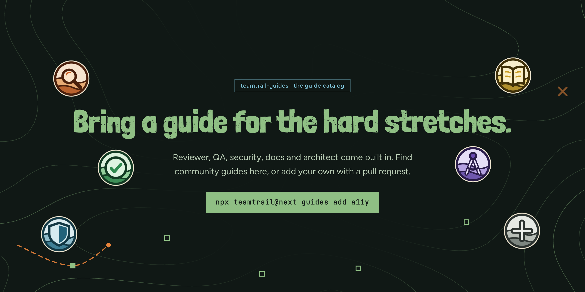

# Teamtrail guides

Guides give your coding agents a role on a ticket: a reviewer, QA, security, docs, an architect, or a specialist someone in the community wrote. A ticket says which guide it needs. Whichever agent claims it, Claude Code, Codex or anything else that speaks MCP, gets the guide's instructions and a checklist it has to answer before the work counts as done.

This repo is the public catalog. Each guide is one plain markdown file in [`guides/`](guides/). Teamtrail reads [`index.json`](index.json) from here when you search for and add guides, so there's no server and no account.

## The guides

<!-- guides:start -->
| Guide | Id | Version | Status | What it does | Author |
| --- | --- | --- | --- | --- | --- |
| [Accessibility](guides/a11y.md) | `a11y` | 1.0.0 | Verified | Checks that new UI works with a keyboard, a screen reader and enough contrast. An example community guide. | Teamtrail (example) |
| [Architect](guides/architect.md) | `architect` | 1.0.0 | Built in | Shapes how the change fits the system before and while it is built. | Teamtrail |
| [Docs](guides/docs.md) | `docs` | 1.0.0 | Built in | Keeps the docs, examples and changelog true to what the code does. | Teamtrail |
| [QA](guides/qa.md) | `qa` | 1.0.0 | Built in | Tests the change like a user would and makes sure the tests cover it. | Teamtrail |
| [Reviewer](guides/reviewer.md) | `reviewer` | 1.0.0 | Built in | Independent review of another agent's finished work before it counts as done. | Teamtrail |
| [Security](guides/security.md) | `security` | 1.0.0 | Built in | Looks at the change as an attacker would before it ships. | Teamtrail |
<!-- guides:end -->

**Built in** guides ship with Teamtrail and work without adding anything; their copies here are for reading. **Verified** means a maintainer reviewed the current version (see [CONTRIBUTING.md](CONTRIBUTING.md)).

## Add a guide to your project

From your repo:

```bash
npx teamtrail@next guides search accessibility
npx teamtrail@next guides add a11y
```

Or open the Lookout (`npx teamtrail@next`), go to **Settings → Guides** and click **Browse guides**. You see each guide's author, review history, checklist, the commands it proposes and its full instructions before you add it.

Adding a guide copies its file into `.teamtrail/guides/` and pins it in `.teamtrail/guides.lock.json`. Commit both, and your teammates get the same guide. Then give a ticket the guide in the Lookout, or let your agent do it when it plans the trail.

## Write your own

A guide is a markdown file with a short header and plain instructions:

```markdown
---
v: 1
id: perf
name: Performance
version: 1.0.0
summary: Measures before and after, on a slow phone.
handles:
  types: [task, execute]
checklist:
  - Measured before and after on the same device
author: Your Name
license: MIT
---

Measure the change on the slowest device you support, before and after, and write both numbers down.
```

Keep it in your own project (`npx teamtrail@next guides add ./perf.md`), or share it here: see [CONTRIBUTING.md](CONTRIBUTING.md). Check it first with `npx teamtrail@next guides lint ./perf.md`.

## Safety

A guide's text goes straight to your agents, so Teamtrail treats it carefully:

- **No code.** A guide is text and a checklist. No scripts, hooks or shell strings.
- **Commands need your approval.** A guide can propose a check command, written as a program and its arguments. It doesn't run until you approve it, and it's then written to your `verification.json` like any other check. If the command changes in a new version, you're asked again.
- **A guide can only add.** It can add checks and a checklist. It can't lower your verification level, skip a check, change who decides, or let an agent review its own work.
- **Pinned and tamper-checked.** Every guide is pinned by its hash. If the file or its lock entry changes outside Teamtrail, the guide is switched off until you approve it again.
- **Linted for prompt injection.** Every guide here passes `teamtrail guides lint`: it flags text that tries to override instructions, answer for the human, approve its own work, touch Teamtrail's files, hide text or send data out, and names the line.
- **Reviewed.** Changes are merged after a maintainer reviews them. If you find a problem, use **Report** in the Lookout or [open a report](../../issues/new?template=report-guide.yml).

## License

MIT, see [LICENSE](LICENSE). Each guide also names its own license.
